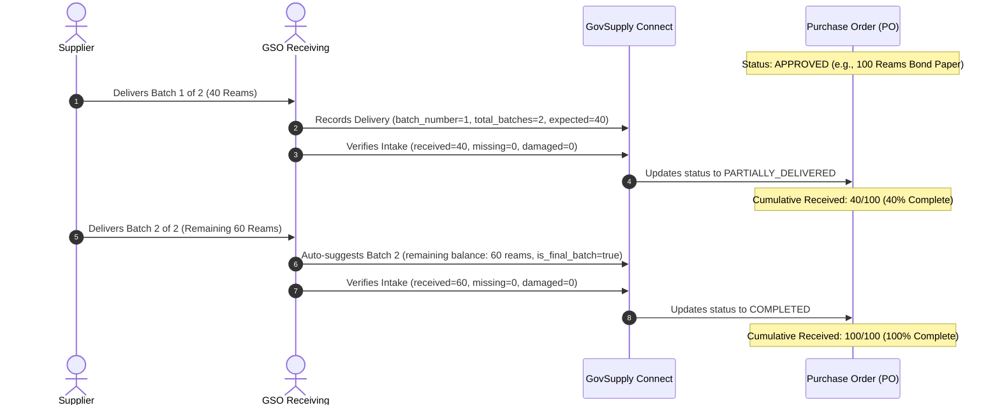

# Statistical Models, Behavioral Baseline Algorithms, and Related Literature

**Project Title:** GovSupply Connect: A Municipal Procurement Transparency and Supply Distribution Monitoring System  
**Proponents:** Jayross Russel D. Herbias, Rieny P. Hulleza, Jeron A. Opjer  
**Adviser:** Jose Leo G. Redoblo, PhD  
**Degree Program:** Bachelor of Science in Information Systems (BS Information Systems)  
**Document Classification:** Capstone Final Defense Technical Specification & Mathematical Documentation  

---

## 1. Executive Overview

This document provides the mathematical foundations, baseline parameter models, taxonomy classifications, and academic literature citations implemented in *GovSupply Connect* in response to the capstone project final defense revisions mandated by the panel and adviser Dr. Jose Leo G. Redoblo.

The system incorporates algorithmic governance, moving municipal procurement surveillance beyond arbitrary static thresholds toward **inferential statistics**, **statistical process control (SPC)**, and **behavioral procurement analytics**.

```
+----------------------------------------------------------------------------------------------------+
|                                    MUNICIPAL PROCUREMENT PIPELINE                                  |
|   PPMP Budget Plan  --->  Office Requisitions  --->  Purchase Orders  --->  Intake & Delivery       |
+----------------------------------------------------------------------------------------------------+
                                           |
                                           v
+----------------------------------------------------------------------------------------------------+
|                                 BEHAVIORAL & STATISTICAL SURVEILLANCE                              |
+----------------------------------------------------------------------------------------------------+
|  1. FINANCIAL VARIANCE            |  2. BEHAVIORAL REQUISITION           |  3. SUPPLY CHAIN INTEGRITY |
|  - Grubbs' Z-Score ($Z \ge 2.0\sigma$) |  - Shewhart 2-Sigma ($UCL = \mu+2\sigma$) |  - Discrepancy Defect Rate |
|  - Pricing Mean & Standard Dev    |  - Sliding-Window Burst Ratio        |  - Damage / Shortage %     |
|  - RA 9184 IRR Price Index        |  - Midpoint Burn-Rate Depletion      |  - Staggered Batch Balance |
+----------------------------------------------------------------------------------------------------+
```

---

## 2. Revision Compliance Matrix

| Defense Revision Requirement | Conceptual Formulation | Implementation Location | Verification Test Suite |
| :--- | :--- | :--- | :--- |
| **1. Advanced statistics kag behavioral algorithms** | Shewhart SPC 2-Sigma, Sliding-Window Demand Velocity, Fiscal Midpoint Burn-Rate Depletion. | `AnomalyDetectionService.php`<br>`AnomalyEvidenceService.php` | `AnomalyTaxonomyAndLiteratureTest.php` |
| **2. Baseline parameters ($\mu, \sigma, Z, N$) & taxonomy** | Explicit computation of Sample Mean ($\mu$), Standard Deviation ($\sigma$), Standardized Score ($Z$), Sample Size ($N$). Tri-category taxonomy. | `Anomaly.php`<br>`AnomalyEvidenceService.php`<br>`InfographicEvidence.tsx` | `AnomalyTaxonomyAndLiteratureTest.php` |
| **3. Staggered multi-batch delivery under same PO ID** | Batch sequencing (`batch_number`, `total_batches`), scheduled line items, partial fulfillment balances, automated transition to `PARTIALLY_DELIVERED`. | `Delivery.php`<br>`DeliveryService.php`<br>`DeliveryVerificationService.php`<br>`Delivery/Create.tsx` | `MultiBatchDeliveryTrackingTest.php` |
| **4. Related literature foundation for Z-score baseline** | Grubbs (1969), Montgomery (2019), World Bank (2020), RA 9184 IRR, COA Circular 2023-004. | `Anomaly.php`<br>`AnomalyEvidenceService.php`<br>`InfographicEvidence.tsx` | `AnomalyTaxonomyAndLiteratureTest.php` |
| **5. Backend denial enforcement (indi na makaproceed)** | Strict backend validation rejecting requisitions with `REJECTED` status at distribution, PR, and PO levels. | `RequestWorkflowController.php`<br>`PurchaseRequestService.php`<br>`DistributionRecordService.php` | `DeniedRequestWorkflowStrictBlockTest.php` |

---

## 3. Mathematical Models & Behavioral Baseline Formulations

### 3.1. Standardized Z-Score Deviation (Grubbs' Outlier Model)

#### Mathematical Definition
For historical procurement unit pricing of an identical commodity code $i$ with historical observations $X = \{X_1, X_2, \dots, X_N\}$:

$$\mu = \frac{1}{N} \sum_{k=1}^N X_k$$

$$\sigma = \sqrt{\frac{1}{N} \sum_{k=1}^N (X_k - \mu)^2}$$

$$Z = \frac{X_{\text{observed}} - \mu}{\sigma}$$

#### Decision Boundaries & Probabilistic Confidence
- **Minimum Sample Size Requirement:** $N \ge 3$ transactions.
- **Warning Outlier Threshold:** $|Z| \ge 2.0\sigma$ ($p < 0.0455$, 95.45% bilateral confidence interval).
- **Critical Outlier Threshold:** $|Z| \ge 3.0\sigma$ ($p < 0.0027$, 99.73% bilateral confidence interval).

#### Capstone Context & Governance Mandate
Prevents uncompetitive municipal supplier pricing, bid rigging, or price inflation above prevailing market standards (Philippine Republic Act No. 9184 IRR Annex H; DBM-PS Municipal Reference Standards).

---

### 3.2. Shewhart Process Control 2-Sigma Boundary (Requisition Volume)

#### Mathematical Definition
For an operating unit's historical requisition quantities for item $j$ across past approvals:

$$\mu_{\text{qty}} = \frac{1}{N} \sum_{k=1}^N Q_k, \quad \sigma_{\text{qty}} = \sqrt{\frac{1}{N} \sum_{k=1}^N (Q_k - \mu_{\text{qty}})^2}$$

$$\text{Upper Control Limit (UCL)} = \mu_{\text{qty}} + 2 \cdot \sigma_{\text{qty}}$$

#### Decision Boundaries
- An incoming supply request item is flagged as an **Excessive Quantity Anomaly** when:
  $$Q_{\text{requested}} > \text{UCL} \quad \text{and} \quad Q_{\text{requested}} \ge \mu_{\text{qty}} \times 1.50$$
- In a normal distribution, values exceeding $\mu + 2\sigma$ reside in the upper 2.28% tail ($p = 0.0228$).

#### Capstone Context & Governance Mandate
Prevents premature inventory hoarding, unauthorized stockpiling, or requisitions exceeding normal departmental operational capacity (COA Circular No. 2023-004 Supply Consumption Integrity & Inventory Buffers).

---

### 3.3. Sliding-Window Frequency Burst Ratio (Demand Splitting Surveillance)

#### Mathematical Definition
For a department $d$ across rolling temporal sliding window $W = [t - 30\text{ days}, t]$:

$$R_{\text{burst}} = \frac{\text{Count}_{30D}(d)}{\bar{C}_{\text{all\_departments}}}$$

Where $\bar{C}_{\text{all\_departments}}$ represents the municipal mean requisition volume per department within the same 30-day window.

#### Decision Boundaries
- **Warning Threshold:** $R_{\text{burst}} \ge 1.80$ (Department requisition velocity is $\ge 180\%$ of municipal baseline).

#### Capstone Context & Governance Mandate
Identifies artificial contract or purchase splitting designed to circumvent competitive bidding thresholds or approval ceilings (Philippine Republic Act No. 9184 Rule II Sec. 7: *Splitting of Contracts and Requisitions*).

---

### 3.4. Fiscal Midpoint Burn-Rate Depletion Model

#### Mathematical Definition
Evaluates cumulative requisition consumption against elapsed fiscal calendar time for an approved Project Procurement Management Plan (PPMP):

$$\tau = \frac{T_{\text{elapsed}}}{T_{\text{annual\_fiscal}}} = \frac{\text{Current Day of Year}}{365}$$

$$\beta = \frac{\sum Q_{\text{consumed}}}{Q_{\text{allocated\_annual}}}$$

$$\text{Velocity Ratio } (V_{\text{burn}}) = \frac{\beta}{\tau}$$

#### Decision Boundaries
- **Early Depletion Flag:** $\beta \ge 0.85$ when $\tau \le 0.50$ ($V_{\text{burn}} \ge 1.70$).
- More than 85% of annual allocated stock consumed before the fiscal mid-year point (July 1).

#### Capstone Context & Governance Mandate
Enforces Local Government Code of 1991 (RA 7160) Sec. 305 and DBM Budget Execution Guidelines regarding annual appropriation discipline.

---

### 3.5. Supply Chain Inspection Discrepancy & Defect Rate

#### Mathematical Definition
During multi-batch or single delivery inspection intake by the General Services Office (GSO):

$$\text{Defect Rate } (D) = \frac{Q_{\text{missing}} + Q_{\text{damaged}}}{Q_{\text{expected}}} \times 100\%$$

#### Decision Boundaries
- **Warning Level:** $5.0\% \le D < 20.0\%$ (Recorded under Supply Chain Integrity).
- **Critical Level:** $D \ge 20.0\%$ (Escalated to Executive Review for supplier warranty or liquidated damages).

#### Capstone Context & Governance Mandate
Enforces RA 9184 Section 68 (Liquidated Damages) and COA Inspection and Acceptance Report (IAR) verification standards.

---

## 4. Anomaly Taxonomy Architecture

The system categorizes all detected irregularities into three formal domains:

```
                                  +------------------------------------+
                                  |     GOVSUPPLY TAXONOMY DOMAINS     |
                                  +------------------------------------+
                                                    |
             +--------------------------------------+--------------------------------------+
             |                                      |                                      |
             v                                      v                                      v
+--------------------------+          +--------------------------+          +--------------------------+
| 1. FINANCIAL_VARIANCE    |          | 2. BEHAVIORAL_REQUISITION|          |3. SUPPLY_CHAIN_INTEGRITY |
+--------------------------+          +--------------------------+          +--------------------------+
| - PRICE_Z_SCORE          |          | - EXCESSIVE_QUANTITY     |          | - DELIVERY_DISCREPANCY   |
|   Grubbs Outlier Test    |          |   Shewhart 2-Sigma UCL   |          |   Missing / Damaged Rate |
|   μ, σ, Z, N Parameters  |          | - FREQUENT_REQUEST_WINDOW|          | - Multi-Batch Schedule   |
|   RA 9184 Price Index    |          |   30-Day Sliding Window  |          |   Deficit Discrepancies  |
|                          |          | - PPMP_OVER_REQUEST      |          |   COA IAR Compliance     |
|                          |          |   Allocation Ceiling     |          |                          |
|                          |          | - PPMP_EARLY_DEPLETION   |          |                          |
|                          |          |   Midpoint Burn Rate     |          |                          |
|                          |          | - PPMP_FREQUENCY_IRREG   |          |                          |
|                          |          |   Demand Splitting Flag  |          |                          |
+--------------------------+          +--------------------------+          +--------------------------+
```

---

## 5. Multi-Batch Delivery Architecture

Staggered intake enables a single Purchase Order (PO) to be fulfilled across multiple scheduled deliveries:



---

## 6. Strict Backend Denial Workflow

When a supply request or distribution is rejected or disapproved, the backend strictly rejects any progression down the procurement pipeline:

```
   [ Office User Submits Request ]
                 |
                 v
   [ GSO Review / Evaluation ]
                 |
       +---------+---------+
       |                   |
   [APPROVE]           [REJECT]
       |                   |
       v                   v
  Status: APPROVED    Status: REJECTED
       |                   |
       |                   x--> Distribution Record Service: BLOCKED (Throws ValidationException)
       |                   x--> Purchase Request Consolidation: BLOCKED (Ignored in query & rejected)
       |                   x--> Purchase Order Generation: BLOCKED (Forbidden)
       v
  Procurement Pipeline Proceeds
```

---

## 7. Related Literature & Citations (APA 7th Edition)

1. **Grubbs, F. E. (1969).** Procedures for detecting outlying observations in samples. *Technometrics*, 11(1), 1–21.  
   *Application:* Mathematical basis for standardized Z-score deviation ($Z = \frac{X - \mu}{\sigma}$) and extreme studentized deviate outlier detection in municipal unit pricing.

2. **Montgomery, D. C. (2019).** *Introduction to Statistical Quality Control* (8th ed.). John Wiley & Sons.  
   *Application:* Statistical Process Control (SPC) Shewhart control charts, $2\sigma$ upper decision boundaries, and quality inspection discrepancy rates.

3. **World Bank. (2020).** *Procurement Data Analytics Guide: Using Data Analytics for Good Governance in Public Procurement.* World Bank Group.  
   *Application:* Red-flag analytical indicators for demand splitting, anomalous requisition frequencies, and transaction clustering within rolling sliding windows.

4. **Juran, J. M., & Godfrey, A. B. (1999).** *Juran's Quality Handbook* (5th ed.). McGraw-Hill.  
   *Application:* Receiving inspection defect rate metrics and discrepancy quantification for public property and supply intake.

5. **Republic of the Philippines. (2003).** *Republic Act No. 9184: An Act Providing for the Modernization, Standardization and Regulation of the Procurement Activities of the Government and for Other Purposes (Government Procurement Reform Act).* Official Gazette.  
   *Application:* Governance framework for Approved Budget for the Contract (ABC), prohibition of artificial contract splitting (Rule II Sec. 7), and liquidated damages (Sec. 68).

6. **Government Procurement Policy Board (GPPB). (2016).** *The 2016 Revised Implementing Rules and Regulations of Republic Act No. 9184.* GPPB Technical Support Office.  
   *Application:* Reference for alternative methods of procurement, price referencing standards, and delivery verification schedules.

7. **Commission on Audit (COA). (2023).** *COA Circular No. 2023-004: Guidelines on the Proper Custody, Inventory, and Consumption of Government Supplies and Materials.* COA Central Office.  
   *Application:* Regulatory justification for inventory consumption tracking, excess stock prevention, and Inspection and Acceptance Report (IAR) discrepancy compliance.

8. **Republic of the Philippines. (1991).** *Republic Act No. 7160: The Local Government Code of 1991.* Official Gazette.  
   *Application:* Local fiscal administration guidelines (Sec. 305) mandating budgetary discipline and mid-year appropriation adherence.
